<h3><code>shaurya@github ~ $ ./contributions.sh</code></h3>

merged from this account and my work account, <a href="https://github.com/shaurya-arcfront"><b>@shaurya-arcfront</b></a>, where most of my day-to-day commits land

  

<h3><code>shaurya@github ~ $ whoami</code></h3>
<table>
  <tr>
    <td valign="top"></td>
    <td valign="top"></td>
  </tr>
</table>

 

<h3><code>shaurya@github ~ $ ls ~/projects</code></h3>

**[BYOS](https://github.com/Astro-Dude/BYOS)** · a cloud drive whose file bytes live in your own Telegram account, with only metadata on the server. Folders, versioning, search, sharing and analytics on a pluggable storage layer; every file points at its current version, so replace and rollback are atomic and public links stay permanent while the file behind them changes. Telegram-as-identity auth with stateless encrypted tickets and rotating refresh tokens, and a bring-your-own-key AI agent with four permission tiers over full-text, trigram and semantic search. Next.js · FastAPI · PostgreSQL · [live](https://byos-web.onrender.com/)

**[DOM Heist](https://chromewebstore.google.com/detail/ejljibcfeobhaehaldildmmgdokmbchc)** · click any element on any website and get a pixel-perfect standalone component, plus a compact spec an LLM can rebuild in React and Tailwind. **600+ installs**, used by **200+ developers at Arcfront**. JavaScript · Manifest V3 · [source](https://github.com/Astro-Dude/VibeExtract)

**[Vector](https://github.com/Astro-Dude/vector/tree/Vector2.0)** · an ed-tech platform I founded and shipped to **400+ students**, with computer-based tests and AI mock interviews backed by vector memory. MERN · TypeScript · Supabase · [live](https://vector-ewgs.onrender.com/)

<h3><code>shaurya@github ~ $ cat contact.txt</code></h3>

[portfolio](https://shauryaverma.vercel.app/) &nbsp;·&nbsp; [linkedin](https://www.linkedin.com/in/astro-dude) &nbsp;·&nbsp; [email](mailto:sagittariusshaurya5@gmail.com) &nbsp;·&nbsp; [work github: @shaurya-arcfront](https://github.com/shaurya-arcfront)

