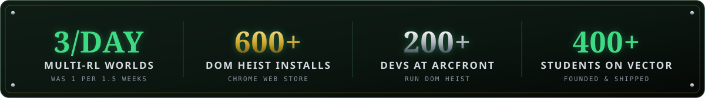
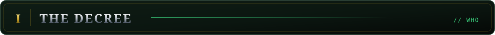
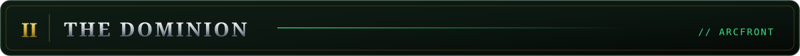
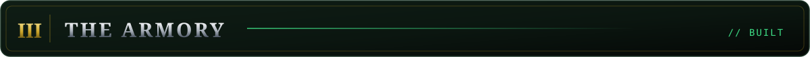
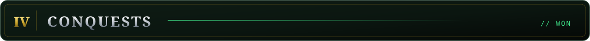
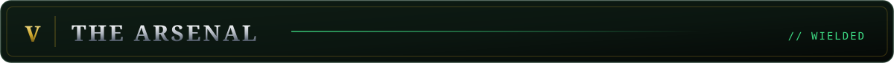

&nbsp;
&nbsp;

i build the worlds ai agents learn in. reinforcement-learning environments where a model has to do real work across real-feeling apps, and graders sharp enough that it can't fake its way to a reward.

off the clock it's astronomy, usually past 3 am. it's the same job, really: stare at something enormous and indifferent until it explains itself. also dostoevsky, who understood people better than any eval i've written. and marvel, which is how this page ended up looking like a doomsday protocol.

founding mts intern at **arcfront**, where i lead the **multi-rl vertical**.

- **multi-rl** · worlds where an agent works across many connected apps at once, the way a person does at an actual job. i lead the vertical and build the internal platform the team uses to create, validate and ship them.
- **the automation** · one environment used to take one engineer a week and a half. i automated the pipeline. now **three ship in a day**.
- **before that** · repository-scale coding environments built from real engineering tasks, with ground-truth patches and adversarial rubrics that catch reward hacking. plus high-fidelity replicas of real-world apps for training llms and vlms.

**BYOS** · bring your own storage. a cloud drive with no storage bill: the bytes live in your own telegram account and byos keeps only the metadata, with folders, versioning, search, sharing and analytics on top of a pluggable storage layer. the favourite part: every file points at its current version, so replace and rollback are atomic, and a public link stays permanent even after the file behind it changes. telegram is the login too, with encrypted stateless tickets and rotating refresh tokens. and a bring-your-own-key ai agent with four permission tiers, searching across full-text, trigram and semantic indexes.
 `typescript` · `next.js` · `fastapi` · `postgresql` &nbsp;·&nbsp; [live](https://byos-web.onrender.com/) &nbsp;·&nbsp; [source](https://github.com/Astro-Dude/BYOS)

**DOM Heist** · point at any element on any website, click, and walk away with it. you get a standalone html file that renders identically offline, plus a compact spec to hand an llm with "rebuild this in react + tailwind". shadow dom, iframes and hover states included. no build step, no npm: the zip writer and serializers are hand-rolled. **600+ installs**, and **200+ developers at arcfront** use it.
 `javascript` · `manifest v3` &nbsp;·&nbsp; [chrome web store](https://chromewebstore.google.com/detail/ejljibcfeobhaehaldildmmgdokmbchc) &nbsp;·&nbsp; [source](https://github.com/Astro-Dude/VibeExtract)

**Vector** · the one i founded. an ed-tech platform shipped to **400+ students**, with computer-based tests and ai mock interviews that use vector memory to give contextual feedback.
 `mern` · `typescript` · `supabase` &nbsp;·&nbsp; [live](https://vector-ewgs.onrender.com/) &nbsp;·&nbsp; [source](https://github.com/Astro-Dude/vector/tree/Vector2.0)

**top 100** · meta pytorch openenv hackathon &nbsp;&nbsp;|&nbsp;&nbsp; **3★** · codechef, max rating 1649 &nbsp;&nbsp;|&nbsp;&nbsp; **finalist** · shaastra programming contest, iit madras

 

